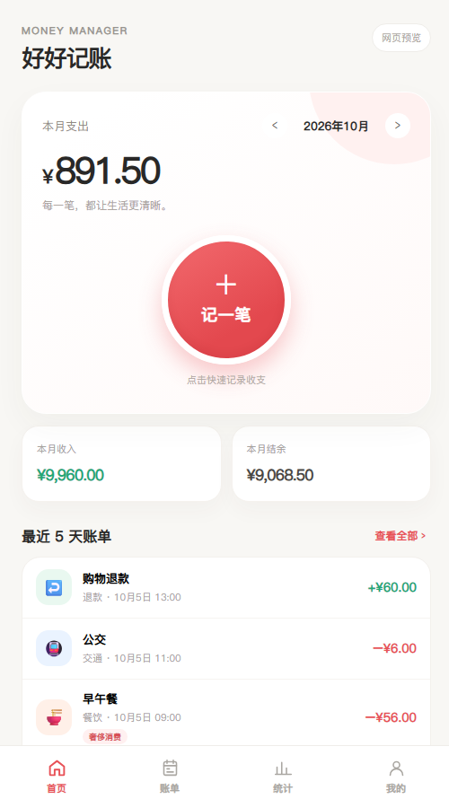

# Money Manager

一个离线使用的 Android 记账 App，适合想按月记录收支、查看统计和定期回顾账单的人。仓库提供 Android 安装版源码、APK 下载和可交互的网页版预览。

账单保存在设备本地，无需注册账号或连接服务器。首次安装是空账本；可通过 JSON 备份迁移数据。

## Android 安装版

- 安装包：[下载 v0.2.0 APK](https://github.com/FeiYang20816/money-manager/releases/download/v0.2.0/money-manager-0.2.0.apk)
- v0.2.0 的金额输入支持加减乘除；在主界面和桌面快捷记账中均可使用。计算结果四舍五入到分后保存。
- 安装与使用：[Android安装与使用.md](Android安装与使用.md)
- 源码与构建说明：[android/README.md](android/README.md)
- 系统要求：Android 8.0 及以上。

首版包含首页快速记账、账单日历与搜索、月度和年度统计、资产计算、月末/年末总结、JSON/CSV 导入导出，以及独立的快捷记账窗口。单笔支出超过 50 元会标记为“奢侈消费”；备注含“校园卡”的记录不计入这项统计。应用内不包含示例账单。

安装后在“我的 → 总结提醒”开启通知，在“我的 → 快捷记账”添加桌面入口。总结在每月最后一天形成，晚上 9 点安排提醒；12 月 31 日同时提醒年度总结。后台调度受系统省电设置影响，可能延迟。

已有 Android 设备的基础使用反馈。不同设备的后台管理可能影响通知送达时间；项目使用系统允许延迟的提醒机制。发行版 APK 通过 GitHub Release 分发，签名密钥和构建缓存不在仓库中。

## 查看网页版

打开 [web/index.html](web/index.html) 即可预览。手机浏览器和电脑浏览器都可以使用；电脑上会显示手机外观预览。

网页版包含四个底部页面：首页、账单、统计、我的。可以记一笔、编辑和删除账单，搜索、切换月份、查看日历和统计；“我的”中可查看资产和自动总结，并下载 JSON 备份、导出或导入 CSV。首次打开会载入示例账单，后续改动保存在当前浏览器。

首页“最近 5 天账单”按自然日显示，账单页会持续标记今天。单笔支出超过 50 元时显示“奢侈消费”；备注包含“校园卡”的记录不计入该项。总资产按“期初资产 + 已记录收入 − 已记录支出”计算。月末和年末自动形成报告，若当时未打开网页，下次打开会补齐。

网页版可用于体验界面与流程。清除浏览器数据可能删除网页中的账单；如需保留，请在“我的”页面下载备份。JSON 备份会包含期初资产设置；CSV 只包含账单记录。网页版与 Android App 的数据不会自动同步。

其他页面预览：[账单日历（今天灰色、选中日期红色）](web/previews/bills.png) · [我的](web/previews/me.png) · [资产](web/previews/assets.png) · [月度总结](web/previews/reports.png)

## 方案

[产品方案书.md](产品方案书.md) 记录功能范围、数据规则、备份方案和当前 Android 实现。

## 反馈

欢迎通过 [GitHub Issues](https://github.com/FeiYang20816/money-manager/issues) 反馈使用问题或提出功能建议。报告问题时请说明 Android 版本、复现步骤和实际表现；请勿附上真实账单或备份文件。
